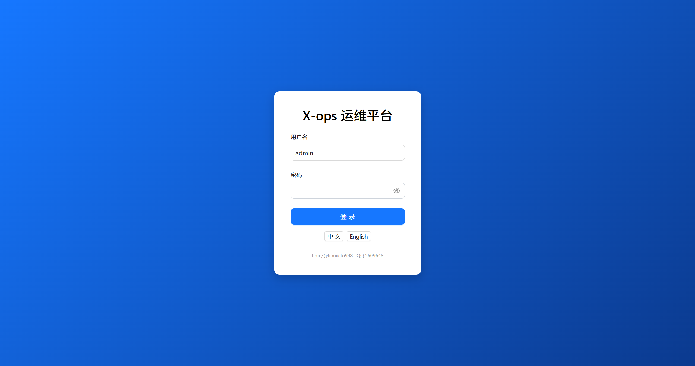
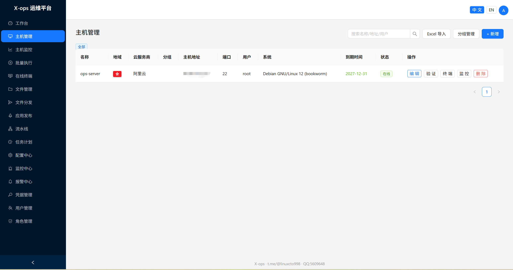
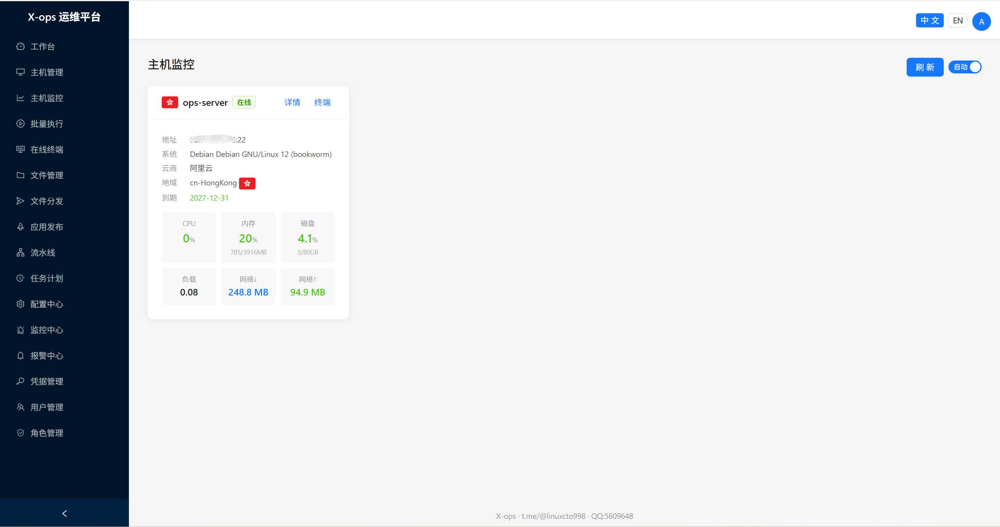
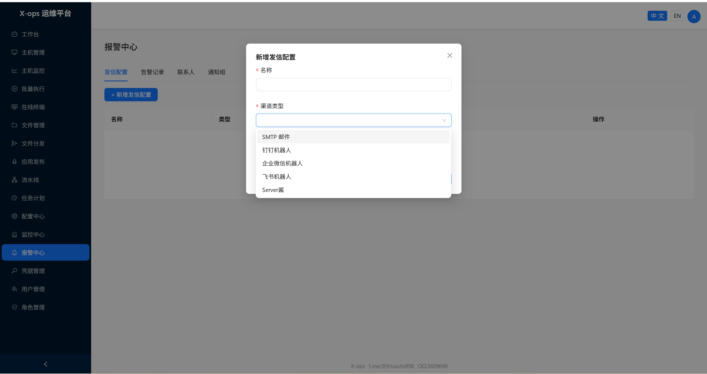

# X-ops 安装文档

本文档覆盖 **Docker Compose** 与 **手动部署（systemd + Nginx + HTTPS）** 两种方式。

- **版权**：t.me/@linuxcto998 · QQ:5609648

---

## 一、环境要求

| 依赖 | 版本 |
|------|------|
| Python | 3.10+ |
| Node.js | 18+ |
| Docker + Compose（可选） | 最新 |
| Redis | 6+ |
| Nginx | 1.18+ |
| 数据库 | SQLite（默认）/ PostgreSQL |

---

## 二、Docker Compose 部署（推荐）

### 2.1 构建前端产物

```bash
cd frontend
npm install
npm run build
cp -r dist ../deploy/frontend-dist
cd ..
```

### 2.2 准备环境变量

```bash
cd deploy
cp ../.env.example .env
# 编辑 .env，至少修改以下项：
#   DJANGO_SECRET_KEY=随机密钥（可用 openssl rand -hex 24 生成）
#   POSTGRES_PASSWORD=数据库密码
#   XOPS_PUBLIC_URL=https://你的域名
```

### 2.3 启动

```bash
docker compose up -d --build
```

### 2.4 创建管理员

```bash
docker compose exec backend python manage.py shell -c "
from django.contrib.auth import get_user_model
U = get_user_model()
if not U.objects.filter(username='admin').exists():
    U.objects.create_superuser(username='admin', password='请修改为强密码', email='admin@example.com')
    print('admin created')
else:
    print('admin exists')
"
```

### 2.5 访问

- HTTP：`http://服务器IP`
- HTTPS：配置好 `XOPS_PUBLIC_URL` 与证书后访问

---

## 三、手动部署（systemd + Nginx + HTTPS）

### 3.1 安装系统依赖（Debian/Ubuntu）

```bash
apt update
apt install -y python3-venv python3-pip redis-server nginx certbot python3-certbot-nginx
```

### 3.2 上传代码

```bash
mkdir -p /opt/x-ops
# 将本仓库 backend/ 上传至 /opt/x-ops/backend
# 将 frontend/dist 上传至 /opt/x-ops/frontend/dist
```

### 3.3 后端环境

```bash
cd /opt/x-ops/backend
python3 -m venv .venv
source .venv/bin/activate
pip install --upgrade pip
pip install -r requirements.txt

# 环境变量
SECRET=$(openssl rand -hex 24)
cat > .env <<EOF
DJANGO_SECRET_KEY=$SECRET
DJANGO_DEBUG=false
DJANGO_ALLOWED_HOSTS=你的域名或IP
REDIS_URL=redis://127.0.0.1:6379/0
EOF

python manage.py migrate --noinput
python manage.py collectstatic --noinput
```

### 3.4 创建管理员

```bash
python manage.py shell -c "
from django.contrib.auth import get_user_model
U = get_user_model()
if not U.objects.filter(username='admin').exists():
    U.objects.create_superuser(username='admin', password='请修改为强密码', email='admin@example.com')
    print('admin created')
"
```

### 3.5 systemd 服务

创建 `/etc/systemd/system/xops-backend.service`：

```ini
[Unit]
Description=X-ops Backend (Daphne)
After=network.target redis-server.service

[Service]
WorkingDirectory=/opt/x-ops/backend
ExecStart=/opt/x-ops/backend/.venv/bin/daphne -b 0.0.0.0 -p 8000 ops_platform.asgi:application
Restart=always
EnvironmentFile=/opt/x-ops/backend/.env

[Install]
WantedBy=multi-user.target
```

创建 `/etc/systemd/system/xops-celery.service`：

```ini
[Unit]
Description=X-ops Celery Worker
After=network.target redis-server.service

[Service]
WorkingDirectory=/opt/x-ops/backend
ExecStart=/opt/x-ops/backend/.venv/bin/celery -A ops_platform worker -l info
Restart=always
EnvironmentFile=/opt/x-ops/backend/.env

[Install]
WantedBy=multi-user.target
```

创建 `/etc/systemd/system/xops-celery-beat.service`：

```ini
[Unit]
Description=X-ops Celery Beat
After=network.target redis-server.service

[Service]
WorkingDirectory=/opt/x-ops/backend
ExecStart=/opt/x-ops/backend/.venv/bin/celery -A ops_platform beat -l info
Restart=always
EnvironmentFile=/opt/x-ops/backend/.env

[Install]
WantedBy=multi-user.target
```

启用并启动：

```bash
systemctl daemon-reload
systemctl enable --now xops-backend xops-celery xops-celery-beat
```

### 3.6 Nginx 配置

创建 `/etc/nginx/sites-available/x-ops`：

```nginx
server {
    listen 80;
    server_name 你的域名;

    root /opt/x-ops/frontend/dist;
    index index.html;

    location / { try_files $uri $uri/ /index.html; }

    location /api/ {
        proxy_pass http://127.0.0.1:8000;
        proxy_set_header Host $host;
        proxy_set_header X-Real-IP $remote_addr;
        proxy_set_header X-Forwarded-For $proxy_add_x_forwarded_for;
        proxy_set_header X-Forwarded-Proto $scheme;
    }

    location /static/ { alias /opt/x-ops/backend/staticfiles/; }

    location /ws/ {
        proxy_pass http://127.0.0.1:8000;
        proxy_http_version 1.1;
        proxy_set_header Upgrade $http_upgrade;
        proxy_set_header Connection "upgrade";
        proxy_set_header Host $host;
        proxy_read_timeout 3600s;
        proxy_send_timeout 3600s;
    }
}
```

```bash
ln -sf /etc/nginx/sites-available/x-ops /etc/nginx/sites-enabled/x-ops
rm -f /etc/nginx/sites-enabled/default
nginx -t && systemctl reload nginx
```

### 3.7 HTTPS（certbot）

```bash
certbot --nginx -d 你的域名 --non-interactive --agree-tos --register-unsafely-without-email --redirect
```

---

## 四、Docker 管理

登录后进入 **Docker 管理**：

1. 顶部选择要管理的主机（需已安装 Docker 且服务运行）
2. **概览**：Docker 版本、容器/镜像/网络/卷统计、引擎信息
3. **容器**：查看全部/运行中/已停止，支持 启动/停止/重启/暂停/恢复/删除，可查看实时日志（最近 300 行）
4. **镜像**：查看仓库/标签/大小，可删除镜像
5. **网络**：查看网络列表（bridge/host 等）

> 服务器安装 Docker：`apt install -y docker.io && systemctl enable --now docker`
> 国内加速：在 `/etc/docker/daemon.json` 配置 `registry-mirrors` 后 `systemctl restart docker`

---

## 五、报警中心发信配置

登录后进入 **报警中心 → 发信配置**：

1. **新增发信渠道**：SMTP 邮件（服务器/端口/SSL/账号/授权码/发件邮箱）、钉钉/企业微信/飞书机器人（Webhook）、Server酱（SendKey）
2. **测试发送**：每个渠道可一键测试
3. **联系人**：邮箱填地址，机器人渠道选择已配置的发信渠道
4. **通知组**：关联联系人
5. **监控规则**：绑定通知组，报警时自动通知

---

## 六、界面截图

部署完成后，登录即可看到以下主要界面：

### 6.1 登录页 / 仪表盘



### 6.2 主机管理



### 6.3 主机监控


### 6.4 批量执行



### 6.5 报警中心



---

## 七、常见问题

| 问题 | 解决 |
|------|------|
| 在线终端连不上 | 确认使用 daphne 启动（`ops_platform.asgi:application`），Nginx 已代理 `/ws/` |
| 监控无数据 | 确认 Redis 与 Celery worker/beat 正常运行 |
| 邮件发不出 | 检查发信配置 SMTP 端口/SSL 与授权码，用"测试发送"验证 |
| 前端白屏 | 确认 `frontend/dist` 存在且 Nginx root 指向正确 |

---

**版权**：t.me/@linuxcto998 · QQ:5609648
